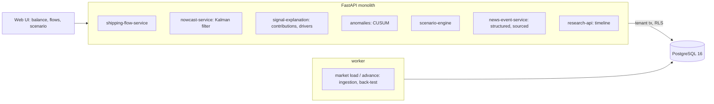

# Global Commodity Market Intelligence Platform

For a research desk watching copper: it joins shipping, exchange stocks, prices and a macro index with official statistics that
arrive two months late, nowcasts the supply-demand balance of the current period with a band and the contribution of each signal,
flags change points in cargo flows, records events with their sources, forecasts exchange stocks ahead, and runs disruption scenarios
that keep structure separate from any claim about where the price goes.

Built from blueprint 9 of "Advanced Engineering Build Book, Volume III" as a **vertical slice**: the demo scenario end to end,
with the platform parts real and the rest listed under [Not built](#not-built-and-why).

**The market is invented: mines, ports, cargoes, prices, statistics and the past come from a simulator in this repository, and the
disruption in the demo is injected by telling the generator what happens. Nothing here is real data or trading advice; the
evaluation shows the price relation is no better than a coin toss at direction, and the page says so.**

## Run it

```bash
docker compose up --build        # migrates, seeds, serves http://localhost:8219/ui/ with one worker
docker compose run --rm test     # 12 tests against a throwaway database (about 3 s)
```

Open http://localhost:8219/ui/ and press **Run all steps** (about 3 seconds), or `make bootstrap demo`.
Demo tokens (local only): `desk-head-demo`, `desk-analyst-demo`, `desk-viewer-demo`. Run `make reset` before a second demo run.

## The demo, step by step

1. Week 288 of an invented copper market: 578 weekly closes (cash and 3-month), 5,281 cargoes, exchange stocks at 961 kt (5 weeks of cover), official production and demand published for 70 periods with an 8-week lag. A two-state Kalman filter (supply, demand) is fitted and back-tested on the last 32 periods: error 2.8 kt/week against 4.9 for a regression on the same signals and 15.8 for the last official figure, with 88% of truths inside its 80% band.
2. Flows: 752 kt at sea on nine routes, what lands in China each of the next four weeks, what each origin shipped last month. The balance view: nowcast +12.8 kt/week (band −2.3 to +27.8), the last official figure 8 weeks old, and each signal's contribution. The nowcast is stored.
3. Eight weeks pass. The generator is told that Chile loses 35% of production for ten weeks and Callao adds two weeks to every voyage for eight; the service sees only prices, stocks, cargoes and two newly published official periods that predate the outage.
4. Change points: Antofagasta departures down 28 kt/week against normal, overdue cargo out of Callao up 31 kt. An analyst records both as events with source URIs.
5. The nowcast rerun: −9 kt/week, a revision of −21.8, decomposed: departures −40.2, stock draws −16.9, the macro index +9.3, re-anchoring on the two newly published periods +26. The last official figure still shows a surplus. The real balance, −3.7, is inside the band. The inventory forecast falls; the page says the filter does not know when the outage ends, and shows that in truth it ends in three weeks.
6. A scenario: the outage runs eight more weeks and the port stays congested four. Stocks in twelve weeks 781 kt against 869 on the baseline; a price band of $6,793 to $7,988 around $7,366 from the fitted price-cover relation, labelled structural and not a forecast. The generator's own future is shown beside it and differs, because the assumption outlasts the real outage.
7. The research timeline (events with sources, both nowcasts with bands, anomalies, the feed's clock) and the audit log.

## Architecture



| Piece | How it works |
|---|---|
| Simulator (`cm/world.py`) | Three mines with utilisation wobble and random outages, three importers with a slow macro cycle and seasonality; the balance moves exchange stocks (half of it visible, off-warrant metal reverting), stocks set weeks of cover, cover sets the price level and the 3-month spread; each week each mine's sea share sails in one to three cargoes per route with a planned and a realised transit. Official figures publish 8 weeks after each 4-week period. |
| Signals | What is visible at a week: departures by origin, stocks, price, spread, macro, and official supply and demand only where published. |
| Observation equations | Fitted on published weeks: departures on last week's supply; stock change on the balance and the stock level; demand on the macro index; AR(1) transitions for supply and demand. |
| Nowcast | Kalman filter over all weeks with the information set of today: official figures anchor the past, proxies carry the recent weeks; the period balance is the filtered state averaged over the period's weeks (projected for those still to come). Each observation's innovation × gain is kept as its contribution; a revision between two runs is decomposed into the new weeks' innovations by signal plus re-anchoring. |
| Baselines | The last official figure; a period-level regression on the same three signals. |
| Inventory forecast | The state projected with its covariance, through the fitted stock equation, 400 paths; a random walk beside it. |
| Change points | Two-sided CUSUM per series, standardised by the trailing year with the last eight weeks excluded; departures by origin and overdue cargo by port. |
| Scenario engine | Assumed cuts lower the balance for their weeks; congestion holds a port's flow at sea for the extra weeks and lands it after; both go through the inventory forecast. Price band from log price regressed on cover, with its residual; labelled structural. |
| Platform | Row-level security per desk, Postgres job queue, Idempotency-Key replay, hash-chained audit log, `/metrics`. |

## Data model

`migrations/002_commodity.sql` follows the blueprint (commodities, instruments, prices, fundamentals, vessel_flows, events, forecasts);
additions are marked `(+)`: markets (seed and clock), week numbers and publication weeks on fundamentals, planned and realised arrival
weeks on cargoes, evidence on forecasts, provenance on events. The blueprint's `embedding VECTOR(1536)` on events is not built: no
language model is used.

## API

| Method | Endpoint | Purpose |
|---|---|---|
| GET | `/v1/commodities/{id}/balance` | Balance nowcast, band, contributions, last official, stocks, cover, price |
| GET | `/v1/flows?commodity=&region=` | Cargoes at sea by route, arrivals ahead, overdue, shipping by origin |
| POST | `/v1/forecasts/nowcast` | Run and store the nowcast and inventory forecast; explain the revision |
| POST | `/v1/scenarios` | Baseline against assumed outages and congestion |
| GET | `/v1/signals/anomalies` | Change points on shipping |
| GET | `/v1/research/timeline` | Events, nowcasts, anomalies, the feed's clock, in order |
| POST | `/v1/events` | (+) A sourced event, recorded by a person or a feed |
| POST | `/v1/market:load` · `/v1/market:advance` | (+) 202 + job: load the market; move the feeds forward (the demo's injection) |

Contract: [`docs/openapi.json`](docs/openapi.json).

## Measured

[`docs/evaluation.md`](docs/evaluation.md) (`python -m cm.evaluate`, three markets and 32 periods each the demo never uses) and
[`docs/performance.md`](docs/performance.md).

| Component | Result | Baseline |
|---|---|---|
| Balance nowcast error (kt/week) | 2.3–2.9 | regression 2.7–4.6; last official 11.8–28.6 |
| Truth inside the 80% band | 84–91% | |
| Exchange stocks 12 weeks ahead (kt) | 39–71 | random walk 45–83 |
| Outages caught | 24 of 32, in 5–7 weeks | 5 false alarms over 18 port-years |
| Price direction 12 weeks out | 34–53% | coin toss 50% |

Three things these numbers say plainly. The nowcast's gain is large because the simulator's relations are stable and the past is from
the same process; a real market would give back some of it. The inventory forecast beats a random walk by a little, and most of what
moves stocks over a few weeks is noise it is honest about. And the price relation predicts the level given stocks, not direction; the
scenario engine uses it only to put a band on an assumed stock path.

## The hardest tradeoff

Where the forecast stops and the causal claim begins. The blueprint asks for scenarios with explicit uncertainty rather than opaque
price calls, and the easy version is a model that emits a price with a band and lets the reader assume it is a forecast. Here the
scenario takes assumptions in (a cut, a delay), propagates them through equations fitted on this market's history, and reports stocks
and cover with Monte Carlo bands; the price band is a translation of the stock path through a fitted level relation, named as such,
with the evaluation showing that relation has no directional skill. The cost is that the page is less exciting than a price target.
The benefit is that every number has a sentence saying what it is.

## Threat model (summary)

| Threat | Mitigation here | Gap |
|---|---|---|
| An event planted without a source | A source URI is required and stored with who recorded it; the audit chain records the write | No check that the source says what the event says |
| A nowcast quietly revised | Every run is stored with its contributions; the revision is decomposed and the previous run named | |
| A scenario read as a forecast | The response carries the relation's residual and a sentence that it is structural; the generator's own future is shown beside it | A reader can still ignore the sentence |
| One desk seeing another's forecasts or events | Row-level security on every table; tested through the API and directly in the database | |

## Not built, and why

- **Exchange, EIA/USGS, NOAA and AIS connectors**: the data is generated; `market:advance` stands in for the feeds moving.
- **News extraction and the embedding column**: events are structured and sourced by a person; no language model is used.
- **A feature store and a dynamic factor model over many series**: three proxies and two states were enough for one commodity; a factor model earns its place with dozens of series.
- **Survival or temporal models for flows**: departures are read as a supply proxy directly.
- **Revisions to official data**: figures publish once and stay; real statistics are revised.
- **More than copper**: the schema allows it; the simulator and the demo do not.
- **Kafka, Redis, OpenTelemetry, Grafana, MLflow, Terraform, CI, SSO, a Next.js front end**: not needed to prove the slice; no cloud account used.

## Commercial sketch

Buyer: producers, trading desks, procurement teams and research firms. Pricing shape from the blueprint: analyst seats, premium
connectors, an enterprise API and commodity packs. The blueprint says to avoid positioning as trading advice; the page says so on
every scenario.

## Layout

```
core/        platform kit: db + RLS, jobs, audit chain, HTTP, scenario runner, load test
cm/          world (market, cargoes, outages), engine (signals, Kalman nowcast, CUSUM, scenarios), api, seed, evaluate
migrations/  forward-only SQL          web/   UI, scenario.json, demo.json (recorded run)
tests/       12 tests                  docs/  evaluation.md, performance.md, openapi.json
```
